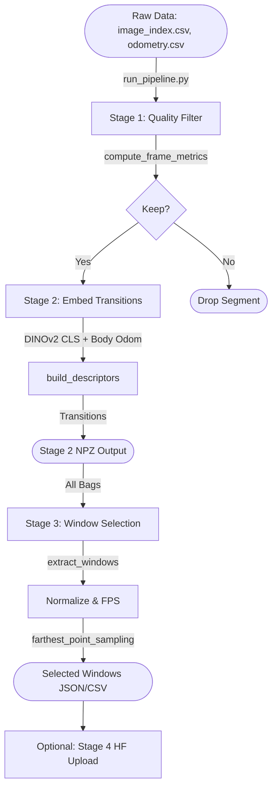

# World Model Data Pipeline

The DINO-WM data pipeline extracts, filters, embeds, and selects high-quality trajectory windows from raw ROS bag outputs for training the World Model.

## Architecture and Flow

The pipeline uses a multi-stage approach to refine the raw data into a diverse, high-quality corpus of transition windows.



## Component Interfaces

### Stage 1: Quality Filtering (`stage1_quality_filter.py`)
**Purpose**: Identifies and drops invalid segments (e.g., blurry frames, stationary periods, missing depth).
- **Inputs**: 
  - `dataset_dir` containing `image_index.csv`, `odometry.csv`, `position_cmd.csv`.
- **Outputs**:
  - `metrics` (DataFrame): Per-frame scores (blur, speed, command magnitudes).
  - `segments` (DataFrame): Contiguous valid sequences.

### Stage 2: Embedding (`stage2_embed.py`)
**Purpose**: Computes compact visual and kinematic representations.
- **Inputs**: 
  - Kept frames from Stage 1.
- **Processing**:
  - `cls_tokens`: 384-dim visual embeddings using `dinov2_vits14`.
  - `odom_deltas`: 6-dim Euclidean relative transform (dx, dy, dz, ax, ay, az).
- **Outputs**: 
  - 390-dimensional descriptors saved as `*_transitions_compact.npz`.

### Stage 3: Diversity Selection (`stage3_select.py`)
**Purpose**: Selects a highly diverse subset of windows using Farthest Point Sampling (FPS).
- **Inputs**: 
  - All valid transitions from Stage 2.
- **Processing**:
  - Extracts sliding windows of length `window_size` (default: 16) spaced by `window_stride` (default: 16).
  - Normalizes the visual and kinematic dimensions using Z-scores independently.
  - Generates gap analysis (K-means on the descriptors) to monitor selection diversity.
- **Outputs**:
  - `selected_windows.csv` and `selected_windows_full.json`.

## Generating the Documentation Locally

To generate this Sphinx documentation:

1. Ensure you have the required dependencies (Sphinx, MyST, AutoAPI) installed:
   ```bash
   pip install sphinx sphinx-autoapi myst-nb sphinxcontrib-bibtex
   ```
2. Navigate to the `docs/` directory:
   ```bash
   cd docs/
   ```
3. Run the Sphinx build command:
   ```bash
   sphinx-build -b html . _build/html
   ```
4. Open the generated documentation in your browser:
   ```bash
   xdg-open _build/html/index.html   # On Linux
   # or `open _build/html/index.html` on macOS
   ```
